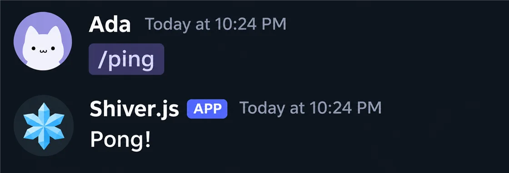
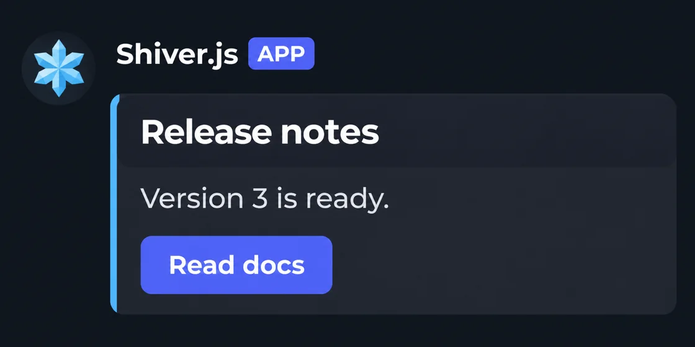
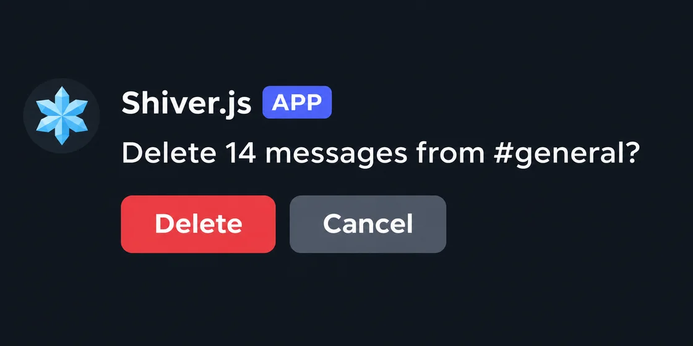
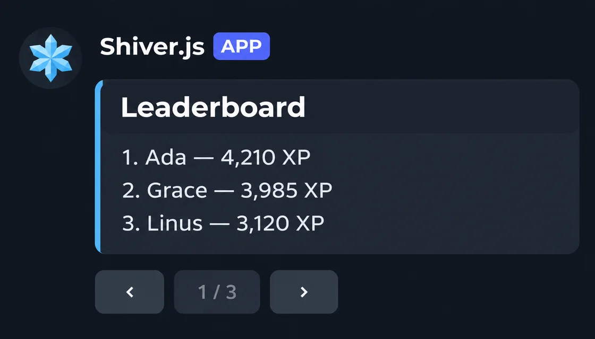

<p align="center">
  <a href="https://shiver.one">
    <picture>
      <source media="(prefers-color-scheme: dark)" srcset=".github/assets/logo-dark.svg">
      
    </picture>
  </a>
</p>

<p align="center">
  A framework for discord.js. Write a command once and it runs as a slash command and a prefix command.
</p>

<p align="center">
  <a href="https://shiver.one/docs/getting-started">Tutorial</a> ·
  <a href="https://shiver.one/docs">Docs</a> ·
  <a href="https://shiver.one/#examples">Examples</a> ·
  <a href="CHANGELOG.md">Changelog</a>
</p>

<p align="center">
  <a href="https://github.com/yuwxbt/shiver-framework/actions/workflows/ci.yml"></a>
  
  
</p>

## What it looks like

This file is a whole command. Save it under your source folder and the bot has `/ping`, and `!ping` if you set a prefix.

```js
import { defineCommand } from 'shiver-framework';

export default defineCommand({
  name: 'ping',
  description: 'Check that the bot is alive',
  run: (ctx) => ctx.reply('Pong!'),
});
```

<p align="center"></p>

shiver.js loads the file, registers the command with Discord, routes the interaction to `run`, and checks the reply against Discord's limits before sending it. You keep full access to discord.js through `ctx.client`, `ctx.interaction` and `ctx.message`.

## Install

You need Node.js 22.13 or later. The package is not on npm yet, so install it from GitHub.

```sh
npx --package github:yuwxbt/shiver-framework shiver init my-bot
cd my-bot
npm install
```

Copy `.env.example` to `.env`, paste your bot token, and run `npm run dev`. The [tutorial](https://shiver.one/docs/getting-started) walks through creating the Discord application and inviting the bot.

To add shiver.js to a project you already have:

```sh
npm i github:yuwxbt/shiver-framework discord.js
```

## The same bot, with and without it

Both versions register `/echo`, answer `!echo` in chat, and reply with an error when the handler throws.

<table>
<tr><th>discord.js only, 59 lines</th><th>With shiver.js, 10 lines</th></tr>
<tr>
<td valign="top">

```js
const command = new SlashCommandBuilder()
  .setName('echo')
  .setDescription('Repeat a message')
  .addStringOption((option) => option
    .setName('text')
    .setDescription('What to say')
    .setRequired(true));

client.once(Events.ClientReady, async () => {
  const rest = new REST().setToken(token);
  await rest.put(
    Routes.applicationCommands(client.user.id),
    { body: [command.toJSON()] },
  );
});

client.on(Events.InteractionCreate, async (i) => {
  if (!i.isChatInputCommand()) return;
  if (i.commandName !== 'echo') return;
  try {
    await i.reply(i.options.getString('text', true));
  } catch (error) {
    // log it, then reply if still possible
  }
});

client.on(Events.MessageCreate, async (message) => {
  if (message.author.bot) return;
  if (!message.content.startsWith('!echo')) return;
  const text = message.content.slice(5).trim();
  if (!text) return message.reply('Usage: !echo <text>');
  await message.reply(text);
});

// plus imports, the client, intents and login
```

</td>
<td valign="top">

```js
import {
  createBot, defineCommand, opt,
} from 'shiver-framework';

const echo = defineCommand({
  name: 'echo',
  description: 'Repeat a message',
  options: {
    text: opt.string('What to say', { required: true }),
  },
  run: (ctx, { text }) => ctx.reply(text),
});

await createBot({ prefix: '!' }).add(echo).start();
```

</td>
</tr>
</table>

The complete 59-line file is on the [homepage](https://shiver.one/#compare).

## What you get

| | |
| --- | --- |
| One definition for slash and prefix | Options are declared once. `!echo hello` is parsed with the same rules as `/echo`, and missing input gets a usage hint. |
| Every Discord component as a function | Buttons, select menus, Components V2 layouts and modal fields return plain API objects. A reply that uses Components V2 gets the flag set for you. |
| Errors that name the fix | A reply that breaks a Discord limit throws before it is sent, for example `a row holds at most 5 buttons, got 6. Split them across rows.` |
| Handlers that survive a restart | Buttons and modals are matched by custom id patterns such as `ticket:close:{id}`, so nothing depends on memory. |
| Tests without a token | `shiver-framework/testing` runs a handler through the real middleware and validation and returns what the bot would have sent. |
| Storage included | Memory, JSON file and SQLite stores share one small interface. SQLite uses Node's built-in module. |
| Offline project checks | `shiver check` loads every definition and reports what is wrong without connecting to Discord. |
| Type declarations | The framework is JavaScript and ships `.d.ts` files. |
| Nothing else to install | discord.js is the only package shiver.js depends on. |

## A reply can be an interface

```js
import { button, container, defineCommand } from 'shiver-framework';

export default defineCommand({
  name: 'release',
  description: 'Show the latest release',
  run: (ctx) => ctx.reply(container(
    { accent: '#4aa8ff' },
    '## Release notes',
    'Version 3 is ready.',
    button({ label: 'Read docs', url: 'https://shiver.one/docs' }),
  )),
});
```

<p align="center"></p>

Confirmation prompts and pagination are one call each:

```js
const yes = await ctx.confirm('Delete 14 messages from #general?', { yes: 'Delete', danger: true });
await ctx.paginate(pages);
```

<p align="center">
  
  
</p>

The pictures in this README are illustrations of what Discord shows. More examples, each with its code, are on [shiver.one](https://shiver.one/#examples).

## Test a command

```js
import assert from 'node:assert/strict';
import { test } from 'node:test';
import { runCommand } from 'shiver-framework/testing';
import ping from '../src/commands/ping.js';

test('ping replies', async () => {
  const result = await runCommand(ping);
  assert.equal(result.text, 'Pong!');
});
```

`runCommand`, `runPrefix`, `runComponent` and `runModal` accept simulated options, permissions, button clicks and modal submissions. See [Testing](https://shiver.one/docs/testing).

## CLI

| Command | What it does |
| --- | --- |
| `shiver init [dir]` | Create a new bot project |
| `shiver new <kind> <name>` | Add a command, component, modal, event or task file |
| `shiver check` | Load and validate every definition offline |
| `shiver manifest` | Print the registration JSON, routes and intents offline |
| `shiver sync` | Register commands with Discord. `--guild <id>` targets one server, `--prune` removes commands that no longer exist locally, `--dry-run` previews the changes |

## Documentation

| Guide | Covers |
| --- | --- |
| [Getting started](https://shiver.one/docs/getting-started) | From an empty folder to a running bot |
| [Configuration](https://shiver.one/docs/configuration) | Every `createBot` option |
| [Commands](https://shiver.one/docs/commands) | Options, subcommands, autocomplete, context menus, prefix |
| [Components and modals](https://shiver.one/docs/components) | Every component type, routing, limits |
| [Messages](https://shiver.one/docs/messages) | Embeds, polls, files, mentions |
| [Middleware](https://shiver.one/docs/middleware) | Cooldowns, permissions, custom guards |
| [Storage](https://shiver.one/docs/store) | Memory, JSON and SQLite stores |
| [Testing](https://shiver.one/docs/testing) | Running handlers without Discord |
| [Deployment](https://shiver.one/docs/deploy) | Syncing commands, hosting, sharding |
| [Errors](https://shiver.one/docs/errors) | Every error code and its fix |
| [Migrating from v2](https://shiver.one/docs/migrating-from-v2) | What changed in the rewrite |

The same guides are in [`docs/`](docs/) as Markdown.

## Working with an AI agent

[`AGENTS.md`](AGENTS.md) describes the whole API in one file, and [`llms.txt`](llms.txt) indexes the guides. Point your agent at `AGENTS.md` and have it run `npx shiver check` after each change. Projects created with `shiver init` include a short agent guide of their own.

## Contributing

Bug reports and pull requests are welcome. Read [CONTRIBUTING.md](CONTRIBUTING.md) first, and report security problems privately as described in [SECURITY.md](SECURITY.md).

```sh
git clone https://github.com/yuwxbt/shiver-framework.git
cd shiver-framework
npm ci
npm run check
```

## License

[Shiver Framework License 1.0](LICENSE). You can use, modify and distribute shiver.js, including inside commercial bots and products. You cannot sell or monetize the framework itself, or a fork of it, as a framework. Keep the license and copyright notice with any copy.

shiver.js is not affiliated with Discord.
